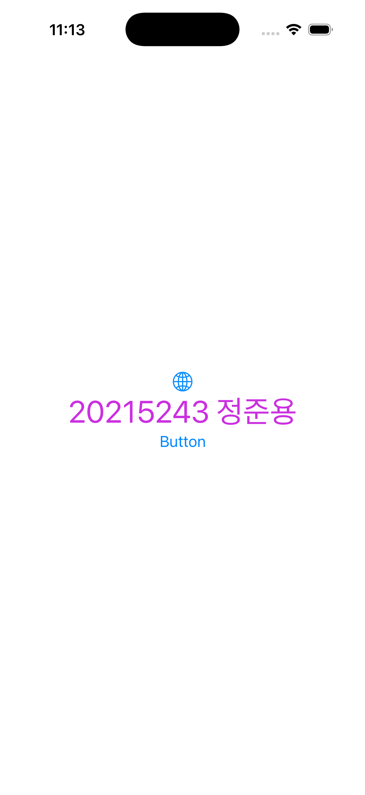

# SwiftUI Practice

> HCI 수업(2026 1학기, 한림대학교)에서 실습한 **SwiftUI iOS 앱** 모음입니다.
> 상태 관리, 데이터 공유, 리스트·내비게이션 등 SwiftUI의 핵심 개념을 작은 앱으로 하나씩 직접 만들어 보았습니다.




## 프로젝트 한눈에 보기

| 프로젝트 | 무엇을 만들었나 | 배운 개념 |
|---|---|---|
| [DemoProject](DemoProject) | Xcode로 만든 첫 SwiftUI 앱 | 프로젝트 구조, `View`, `#Preview` |
| [SwiftUiDemo](SwiftUiDemo) | 슬라이더·텍스트필드·피커로 텍스트를 회전·편집·색 변경 | `@State`, 바인딩(`$`), 애니메이션 |
| [ObserveableDemo](ObserveableDemo) | 1초마다 올라가는 타이머를 세 화면에서 공유 | `ObservableObject`, `@Published`, `@StateObject`, `@EnvironmentObject` |
| [ListNavDemo](ListNavDemo) | 전기차 목록 앱 — 상세 보기, 추가, 삭제, 순서 변경 | `List`, `NavigationStack`, `NavigationPath`, JSON 디코딩 |

---

## 1. SwiftUiDemo — 상태와 바인딩

사용자 입력이 바로 화면에 반영되는 인터랙티브 UI.

- **Slider**로 텍스트를 0~360° 회전 (`.rotationEffect` + `.easeInOut` 애니메이션)
- **TextField**로 표시할 문구를 실시간 편집
- **Wheel Picker**로 글자 색 선택

```swift
@State private var rotation: Double = 0

Text(text)
    .rotationEffect(.degrees(rotation))
    .animation(.easeInOut(duration: 5), value: rotation)

Slider(value: $rotation, in: 0...360, step: 0.1)
```

## 2. ObserveableDemo — 여러 화면이 같은 데이터 공유

`Timer`로 1초마다 값이 오르는 `TimerData`를 만들고, 첫 화면에서 `environmentObject`로 주입해
**두 번째·세 번째 화면이 같은 카운트를 함께 보도록** 구성했습니다.
처음엔 화면마다 객체를 넘기는 방식(주석 처리된 코드)으로 만들고, 이후 `@EnvironmentObject`로 바꿔 두 방식을 비교했습니다.

```swift
class TimerData: ObservableObject {
    @Published var timeCount = 0
}

// ContentView
NavigationView { ... }.environmentObject(timerData)

// SecondView, ThirdView
@EnvironmentObject var timerData: TimerData
```

## 3. ListNavDemo — 리스트 + 내비게이션 CRUD

`carData.json`을 읽어 전기차 목록을 보여주는 앱.

- **목록 → 상세** 이동: `NavigationStack(path:)` + `navigationDestination(for:)`
- **추가**: `Form` 입력 화면에서 새 차량을 만든 뒤 `path.removeLast()`로 목록에 복귀
- **삭제 / 순서 변경**: `EditButton` + `.onDelete` / `.onMove`
- **데이터 로딩**: 제네릭 `loadJson<T: Decodable>`로 번들의 JSON 디코딩

```
ListNavDemo/
├─ Car.swift          모델 (Codable, Identifiable)
├─ CarData.swift      JSON 로더
├─ CarStore.swift     ObservableObject 저장소
├─ ContentView.swift  목록 + 내비게이션
├─ CarDetail.swift    상세 화면
└─ AddNewCar.swift    추가 폼
```

## 4. DemoProject — 첫 프로젝트

Xcode에서 iOS App 템플릿으로 프로젝트를 만들고 시뮬레이터에서 실행해 본 출발점입니다.

---

## 실행 방법

1. macOS + **Xcode 26 이상** 필요 (iOS 26.4 타깃)
2. 원하는 프로젝트 폴더의 `.xcodeproj` 열기 (예: `ListNavDemo/ListNavDemo.xcodeproj`)
3. 시뮬레이터 선택 후 <kbd>⌘</kbd> + <kbd>R</kbd>

## 참고

수업 교재 예제를 따라 구현하며 SwiftUI의 기본 개념을 익힌 학습용 코드입니다.
